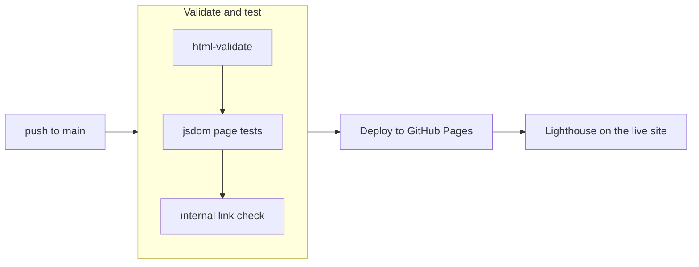

# devops-portfolio

[](https://github.com/MPeets/devops-portfolio/actions/workflows/ci.yml)

My DevOps / SRE portfolio: **https://mpeets.github.io/devops-portfolio/**

It's a static site with two case studies, each with something to click:

- **[Cloud-native deployment platform](https://github.com/MPeets/cloud-native-deployment-platform)**: an architecture diagram you can inspect, a pipeline replay with a manual approval gate and an injectable tfsec finding, and a drift report.
- **[Air-gapped observability lab](https://github.com/MPeets/airgapped-observability-lab)**: an alert simulator built on the lab's real Prometheus rules, and a step-through of the offline install.

The site is tested and deployed the same way as the projects it shows off.

## How it ships



- **html-validate** checks every page against the recommended ruleset.
- **Page tests** (`tests/site.test.mjs`) load each page in jsdom, run the real scripts and click through the interactive parts: the pipeline has to stop at the approval gate, a security finding has to stop it before plan, an alert has to walk from pending to notified. Any script error fails the run.
- **lychee** checks internal links on every push. External links get a weekly scheduled check instead, so someone else's outage can't block a deploy.
- The deploy writes `build.json` with the commit SHA and run URL. The footer reads it, so every page links back to the run that built it.
- **Lighthouse** runs against the live URL after each deploy. Accessibility below 90 fails the job; performance, best practices and SEO warn.
- Every action is pinned to a commit SHA. Dependabot opens one grouped PR a month for actions and npm.
- Placeholder text left on a page shows up as a warning annotation on the run.

## What it costs

Nothing. The repo is public, so GitHub Actions minutes on GitHub-hosted runners and GitHub Pages hosting are free. There's no framework, no build step and no cloud account. The only thing that would ever cost money is a custom domain, and that's optional.

## Project layout

```
site/                 everything that gets deployed
  index.html          home
  platform.html       cloud-native platform case study
  lab.html            air-gapped lab case study
  404.html            shown by Pages for unknown paths
  assets/css/         one stylesheet
  assets/js/          common.js (diagrams, live CI status, build stamp) + one script per page
tests/                jsdom tests for the pages
.github/workflows/    ci.yml (test, deploy, audit) and links.yml (weekly external links)
```

The project cards on the home page fetch each repo's latest `ci.yml` run and last push from the public GitHub API, cached per browser session so visitors stay well under the unauthenticated rate limit.

## Run it locally

```bash
npm ci
npm run check    # html-validate + page tests
npm run serve    # http://localhost:8000
```

## Still to fill in

Search the pages for `TODO`:

- Years for the SimplBooks and Paljassaare roles, and the self-taught start
- Email, LinkedIn and CV links in the hero and contact section
